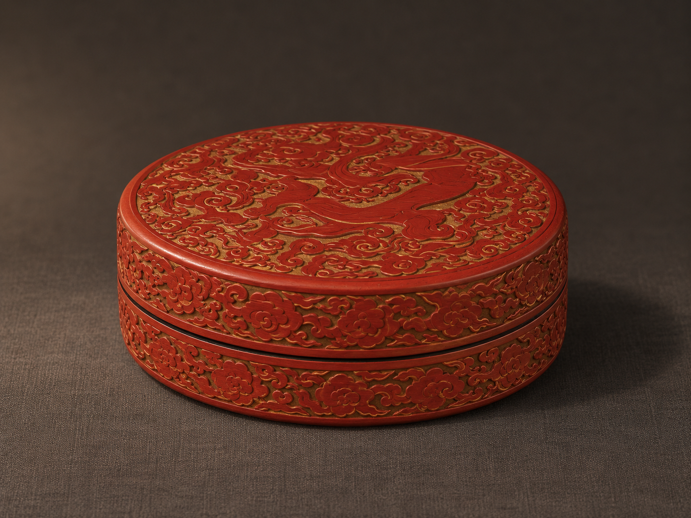
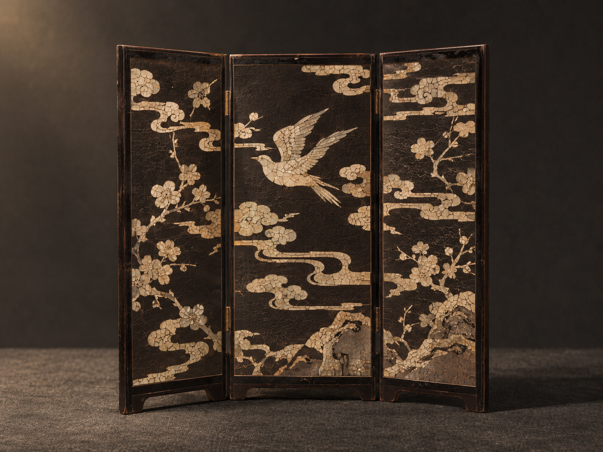

# 云展馆设计资源

> 更新日期：2026-11-19  
> 关联规范：[云展馆核心视觉元素设计规范](../云展馆核心视觉元素设计规范.md)  
> 章节封面提示词：[covers/生图提示词.md](covers/生图提示词.md)  
> 藏品主图提示词：[artifacts/生图提示词.md](artifacts/生图提示词.md)

## 1. 已写入项目的图片

### 1.1 章节封面

| 源文件 | 项目文件 | 数据库字段 | 对应章节 | 交付尺寸 | 体积 |
| --- | --- | --- | --- | --- | --- |
| `covers/分支参观.png` | `chapter-branch-3x2.jpg` | `chapter.cover_url` | 互动体验 · 分支参观 | 1500 × 1000 | 178KB |
| `covers/接去.png` | `chapter-main-3x2.jpg` | `chapter.cover_url` | 第一章 · 千年漆语 | 1500 × 1000 | 181KB |
| `covers/tab.png` | `chapter-artifacts-3x2.jpg` | `chapter.cover_url` | 第二章 · 器物之美 | 1500 × 1000 | 158KB |

项目内访问路径：

```text
/seed/chapter-branch-3x2.jpg
/seed/chapter-main-3x2.jpg
/seed/chapter-artifacts-3x2.jpg
```

首页 hero 另复制为小程序内置资源（当前使用漆树图 `chapter-main-3x2.jpg`）：

```text
fronted/漆器云馆/static/hero/home.jpg
```

由 `pages/index/index.vue` 直接引用，不依赖后端；即使接口不可用，首页主视觉也能正常显示。

### 1.2 藏品主图

| 源文件 | 项目文件 | 数据库字段 | 对应藏品 | 交付尺寸 | 体积 |
| --- | --- | --- | --- | --- | --- |
| `artifacts/雕填云纹漆盒.png` | `artifact-diaotian-box.jpg` | `artifact.main_image_url` | 雕填云纹漆盒 | 1600 × 1200 | 265KB |
| `artifacts/漆碗.png` | `artifact-tin-bowl.jpg` | `artifact.main_image_url` | 嵌锡漆碗 | 1600 × 1200 | 157KB |
| `artifacts/漆屏.png` | `artifact-eggshell-screen.jpg` | `artifact.main_image_url` | 隐花漆屏 | 1600 × 1200 | 271KB |

项目内访问路径：

```text
/seed/artifact-diaotian-box.jpg
/seed/artifact-tin-bowl.jpg
/seed/artifact-eggshell-screen.jpg
```

### 1.3 备用图

`artifacts/主图.png` 是一张盖碗类漆器通用图，暂未对应到具体藏品，也没有写入数据库；需要时可作为新增藏品的备选主图。

## 2. 数据库写入

执行脚本：

```text
qi/sql/upgrade-20261119-design-assets.sql
```

脚本会：

- 按章节标题或旧封面路径，把三章封面切换到 `/seed/chapter-*-3x2.jpg`。
- 按藏品名称或旧主图路径，把三件藏品主图切换到 `/seed/artifact-*.jpg`。
- 脚本可重复执行，不会产生副作用。
- 执行后附带两条核对查询，直接查看 `chapter.cover_url` 与 `artifact.main_image_url`。

静态资源文件位于：

```text
qi/src/main/resources/static/seed/
```

Spring Boot 默认把 `static/` 映射到根路径，因此数据库里保存 `/seed/xxx.jpg` 即可，不需要写 `http://localhost:8080`。

## 3. 预览

### 互动体验 · 分支参观


漆盘、刻刀、螺钿小碟与毛笔置于暖光工作台上，用工具与材料暗示分支体验的两种路径。

### 第一章 · 千年漆语


漆树割口、乳白漆液、漆碗与宣纸，建立“从树液到器物”的材料叙事。

### 第二章 · 器物之美


红雕漆盒陈列于深色木台，金色山水纹样与暖光形成博物馆式观看氛围。

### 雕填云纹漆盒



圆形红漆盒，盖面为云龙纹。源文件按“雕填”命名，但画面更接近雕漆效果；正式上线前请内容人员核对工艺名称与说明文字。

### 嵌锡漆碗


黑褐漆碗，银灰色锡片嵌成云纹，锡片与漆面磨平齐。

### 隐花漆屏



三扇深色漆屏，屏心以蛋壳碎片镶嵌花鸟与云纹，保留天然冰裂纹。

## 4. 使用方式

1. 图片已放入后端静态资源目录，执行 SQL 后即可生效。
2. 小程序端保持 `mode="aspectFill"`：
   - 章节卡片 170 × 130rpx、章节 hero 686 × 420rpx，共用 3:2 封面。
   - 藏品列表卡约 300 × 240rpx（当前代码 340 × 300rpx），详情通栏 750 × 560rpx，共用 4:3 主图。
3. 章节 hero 仍需叠加设计规范中的 `.hero-mask`，保证白色标题对比度。
4. 后台「章节编辑」「藏品编辑」中可以看到新路径；如需换图，直接改 `cover_url` / `main_image_url`。

## 5. 重要说明

- 本组图片为 **AI 生成的概念稿**，用于设计确认、课程演示与前端联调，不是真实馆藏文物。
- AI 生成的器物形制、纹饰细节可能与真实历史器物不符；正式发布前需由内容人员核对，或替换为有明确授权的馆藏摄影。
- `雕填云纹漆盒` 的源图更接近雕漆效果，工艺名称与图片细节需要在内容层面再核对一次。
- 本次 PNG 源图未发现可见水印；如重新生成，仍需检查右下角水印、伪汉字、印章与签名。
- 新增人物相关图片时，必须取得本人授权，并重点检查 AI 生成的手部结构。

## 6. 正式稿素材来源建议

如需把概念稿替换为真实馆藏照片，优先使用开放授权（CC0 / Public Domain）来源：

- [The Met Open Access](https://www.metmuseum.org/art/collection/search?showOnly=openAccess&q=lacquer)：中国漆器藏品，下载前确认单件作品为 Open Access。
- [Wikimedia Commons · Chinese lacquerware](https://commons.wikimedia.org/wiki/Category:Chinese_lacquerware)：逐张核对作者、许可与署名要求。
- [Art Institute of Chicago](https://www.artic.edu/collection?q=lacquer)：筛选 public domain 作品。
- [Cleveland Museum of Art Open Access](https://www.clevelandart.org/art/collection/search?q=lacquer)：CC0 资源较多。

下载后必须在 `README` 或内容后台登记：作品名、作者/机构、来源链接、许可类型、授权说明。来源不明或仅标注“网络图片”的素材不得上线。
