# 蜀漆云馆 · 漆器展示资料

> 整理日期：2026-11-14
>
> 范围：微信小程序「漆器云馆」实际对外展示的内容与配套静态资源。
>
> 数据口径：仅收录已发布（`status=1`）且未删除（`deleted=0`）的记录；草稿、已下架与 smoke 测试数据不纳入。
>
> 图片来源：封面与正文配图存放于仓库 `qi/src/main/resources/static/seed/`，小程序运行时由后端以 `http://localhost:8080/seed/...` 提供。本文档内图片使用仓库相对路径，可直接预览。

正文中**加粗**的词是正文里的术语标记（`[[term:ID]]`），在小程序中可点按查看释义；术语释义见[第七节](#七术语释义)。

## 一、展示总览

| 内容类别 | 展示数量 | 小程序中的位置 |
| --- | --- | --- |
| 章节 | 3 | 「云展馆」章节列表与章节详情页 |
| 叙事节点 | 22 | 章节详情页按阅读顺序展开 |
| 藏品 | 3 | 「藏品」列表、藏品详情页 |
| 传统工艺 | 1（含 4 道工序） | 工艺详情页、章节工序节点 |
| 传承人 | 2 | 传承人列表、传承人详情页、章节口述节点 |
| 纹饰 | 3 | 纹饰资料页 |
| 术语 | 5 | 正文术语浮层 |
| 历史事件 | 4 | 章节时间轴节点 |
| 内容关联 | 10 条 | 章节与藏品详情页的关联卡片 |

展示顺序按 `sort_order` 排列：互动体验 · 分支参观 → 第一章 · 千年漆语 → 第二章 · 器物之美。

## 二、章节与叙事节点

三个章节依次串起「怎样看 → 为什么美 → 如何做」的参观线索：先在分支参观中建立兴趣，再沿千年漆语了解材料与历史，最后从三件器物进入工艺细节。

> 原文说明：分支参观中有三个节点（制胎坊·骨架之美、制胎坊·深入一步、饰纹坊·深入一步）的正文保留了未替换的 `【t7】`、`【t10】`、`【t9】` 占位符，属数据库中实际存储的内容，本文档按原样呈现。

### 互动体验 · 分支参观

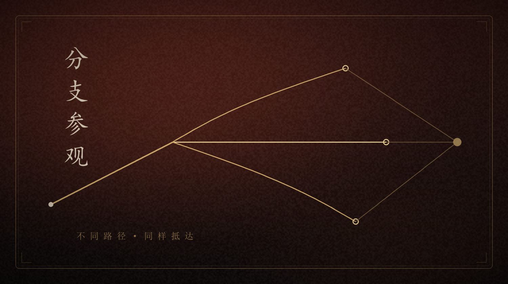

> 在分支里走出你的参观路线

本章演示分支叙事：在分支点做出选择，走向不同的内容路线，殊途同归后再继续下一章。

#### 1. 入行：从一滴漆开始　`图文`

漆农凌晨进山割漆，「百里千刀一斤漆」，说的就是**大漆**的珍贵。收得的生漆要经晾制、过滤，才能成为可用之漆。

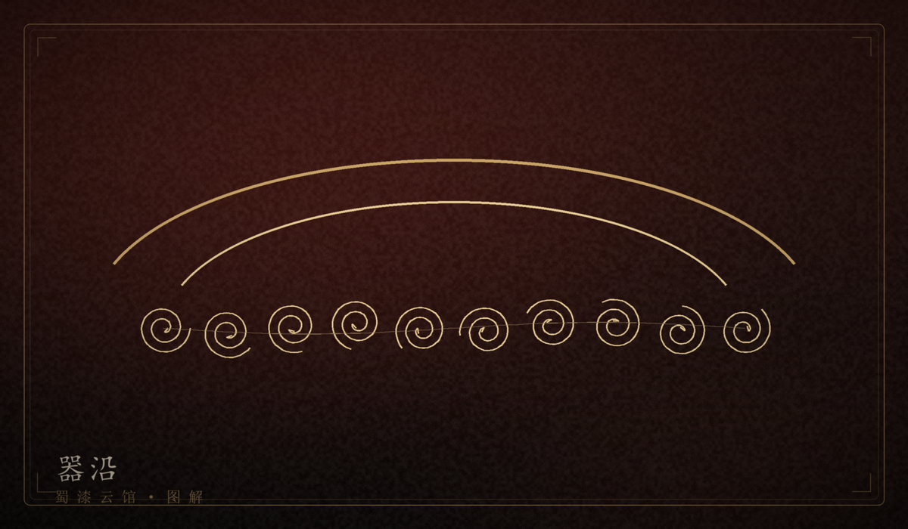

漆的干燥不靠晒，靠**荫房**里的温湿度。走进工坊，你会先闻到那股独特的酸香——那是大漆在呼吸。

#### 2. 两条参观路线　`图文`

接下来的参观分成两条路线：**制胎坊**看器物的骨架——一件漆器七分靠胎；**饰纹坊**看刀口上的功夫——雕填是成都漆艺的看家本领。

两条路线各有两站，走完殊途同归。在下面的分支卡做出你的选择。

#### 3. 分支抉择 · 你的参观路线　`分支`

两条路线各有看点：制胎坊看器物的骨架功夫，饰纹坊看刀口上的雕填绝活。选一条，我们现在就走。

可选路线：

- **去制胎坊 · 看骨架功夫** → 第 4 节「制胎坊 · 骨架之美」
- **去饰纹坊 · 看雕填刀口** → 第 5 节「饰纹坊 · 刀口生花」

#### 4. 制胎坊 · 骨架之美　`图文`

制胎是漆器的第一道关。木旋胎、夹纻胎各有性格：木胎规整，夹纻轻巧。【t7】的整形精度，决定了一件漆器十年后是否依然周正。

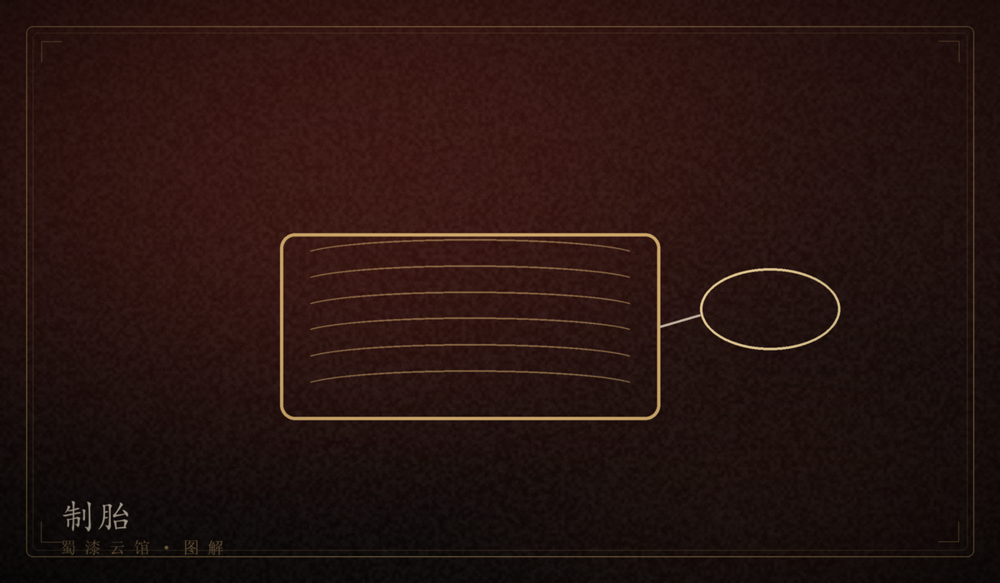

#### 5. 饰纹坊 · 刀口生花　`图文`

饰纹坊里安静得只听得见刀声。雕填在厚漆层上走刀，填色、贴金，每一条线都要一次到位——漆层刻坏了无法补救。

#### 6. 制胎坊 · 深入一步　`图文`

胎骨成型之后是裱布刮灰：麻布封固胎身，漆灰填平木纹。这一步做得足，漆器才经得起几十年的冷热交替。

刮灰后的胎体要反复荫干——【t10】的湿度卡在七成上下，急不得。

#### 7. 饰纹坊 · 深入一步　`图文`

【t9】之后是整体抛光：瓦灰蘸油，手工推光，直到漆面映得出人影。嵌锡技法的锡片也在这一步磨平，与漆面浑然一体。

一件中型漆盒的饰纹，一位熟手要专注两周。

#### 8. 汇合：殊途同归　`图文`

无论你走了哪条路线，最后看到的都是同一件事：一件漆器是「层累的艺术」——胎上一层灰，灰上一层布，布上一层又一层的漆，漆上再雕刻、再打磨。

接下来去「第一章 · 千年漆语」，把这条时间线完整走一遍。

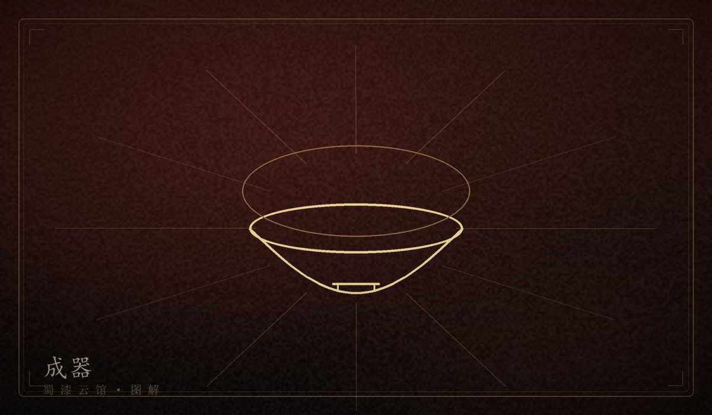

### 第一章 · 千年漆语

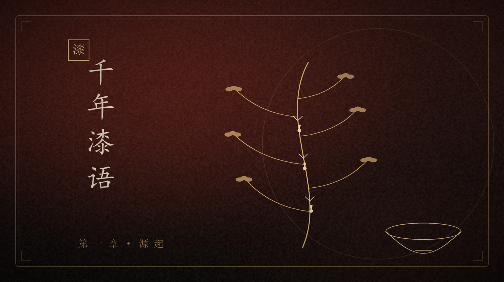

> 从一棵漆树到一件漆器

本章从漆树割漆讲起，沿时间脉络走到成都漆艺的工坊里，听匠人亲述，再看一遍完整的制漆流程。

#### 1. 割漆：一滴漆的诞生　`图文`

漆农凌晨进山，在漆树干上割开一道浅浅的口子，乳白的漆液顺着刀痕缓缓渗出。一棵漆树整个夏天只能割取几斤**大漆**，故有「百里千刀一斤漆」之说。

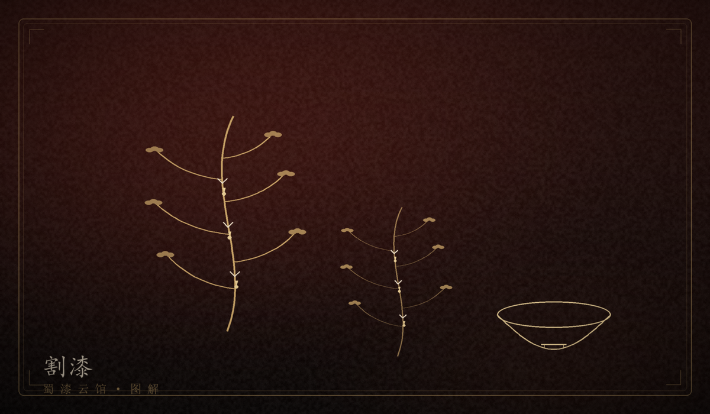

收得的生漆经滤去杂质、晾制水份，成为可以入用的精制漆。漆的干燥依赖荫房温湿度——**荫房**里的每一层漆膜，都是时间与耐心的合物。

#### 2. 髹涂：层层累积的功夫　`图文`

**髹涂**是漆器成型的核心：在**胎体**上反复涂施、荫干、打磨。器物表面温润的光泽，来自数十道漆层叠加后的整体推光。

成都漆艺的看家本领**雕填**，正是在这厚厚的漆层上做文章——雕出纹样，再以色漆或金银填之。

#### 3. 千年脉络　`时间轴`

| 时期 | 事件 | 说明 |
| --- | --- | --- |
| 商周时期 | 漆用作礼器涂饰 | 商周时期，漆已用于木器与礼器的涂饰保护，漆器与青铜器并行发展，成为早期礼制生活的重要材质。 |
| 战国至秦汉 | 楚漆器的黄金时代 | 战国至秦汉，楚地漆器造型奇巧、纹饰飞扬，饮食器、家具、葬具全面漆化，是中国漆器史上的第一个高峰。 |
| 汉代 | 蜀郡漆器名满天下 | 汉代成都设工官专管漆器生产，蜀郡漆器远销边疆与海外，「蜀汉工官」的铭文漆器屡有出土。 |
| 明清时期 | 雕填与嵌锡技艺成熟 | 明清时期，成都漆艺的雕填、嵌锡、隐花等技法日臻成熟，宫廷与民间互为滋养，形成地方特色体系。 |

#### 4. 匠人自述　`口述`

> 漆要人养，人也要靠漆磨性子。一年只做几件东西，做一件就得对得起一件。
>
> —— 张永贵（演示）　（工坊访谈（演示），演示授权）

#### 5. 一件漆器的完整流程　`工序`

演示口径：工序因器而异，以工坊实际安排为准。

关联工艺：**成都漆艺**

| 工序 | 说明 |
| --- | --- |
| 制胎 | 选木旋制或夹纻塑形，做出器物骨架，要求壁厚均匀、接口严合。 |
| 裱布刮灰 | 胎体裱糊麻布、刮漆灰，封固胎面并增加强度，防裂防变形。 |
| 髹涂 | 反复髹涂大漆，每道入荫房荫干后打磨，累积漆层至足够厚度。 |
| 雕填抛光 | 在厚漆上雕出纹样，填入色漆或金银箔，整体推光至温润如玉。 |

#### 6. 漆与生活　`图文`

漆器从来不只是博物馆里的陈列：食器、妆奁、文具、家具，古人的日常被大漆温柔包裹。汉代蜀郡漆器远销各地，凭的就是「好用」二字。

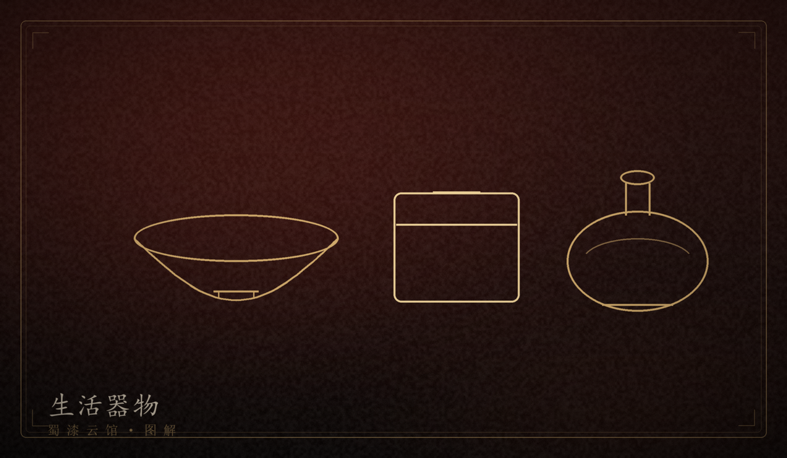

#### 7. 纹样里的天地　`图文`

云气纹流转，是古人对天地呼吸的想象；卷草纹蔓卷，是生生不息的祈愿；变体鸟纹飞扬，带着楚文化自由不羁的血统。

读纹样，就是在读造器人的精神世界。

#### 8. 青年视角　`口述`

> 老手艺要活在新生活里，才能传得下去。我把雕填纹样做进文创，就是想让年轻人先「看见」，再「喜欢」。
>
> —— 李秀英（演示）　（工作室访谈（演示），演示授权）

本章关联：藏品「雕填云纹漆盒（演示）」、工艺「成都漆艺」、传承人「张永贵（演示）」

### 第二章 · 器物之美

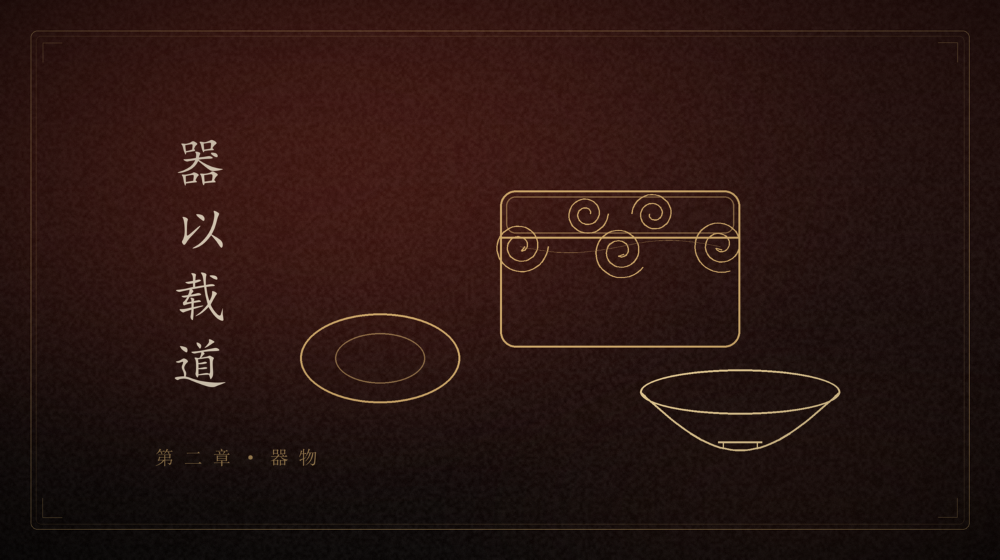

> 三件器物，三种性格

漆盒、漆碗、漆屏——三种器类，三种技法性格。看完这一章，你会认得出雕填、嵌锡与蛋壳镶嵌。

#### 1. 器以载道　`图文`

漆器之美，不在材料贵重，而在工艺与时间的复利。认识一件漆器，先看胎骨是否周正，再看漆色是否温润，最后细读纹样的刀口。

#### 2. 三件器物的故事　`图文`

雕填云纹漆盒沉得住气，嵌锡漆碗亮得出巧，隐花漆屏藏得住惊喜。点开下方关联卡片，逐一细看它们的工艺与故事。

#### 3. 细看 · 雕填云纹漆盒　`图文`

盒盖云气纹以刀代笔，走刀的起收与漆层的厚度直接相关。填金处洗练含蓄，是雕填工艺的性格。

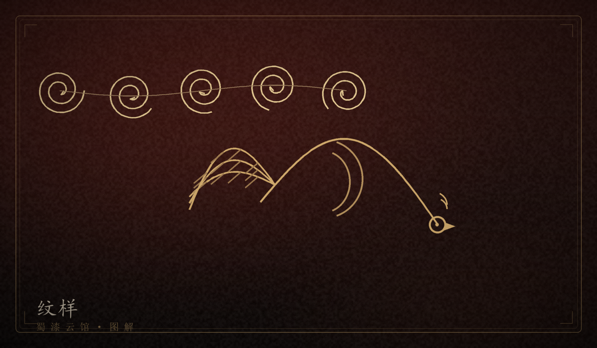

#### 4. 细看 · 嵌锡漆碗　`图文`

锡片嵌入漆层再磨平，银亮与深沉互为映衬。嵌锡是成都漆艺独有的技法，考验的是「分寸」二字。

#### 5. 细看 · 隐花漆屏　`图文`

屏心蛋壳镶嵌：蛋壳裂出的天然冰纹，在深色漆面上如月光浮出。双面可观，是漆艺与家具的结合体。

#### 6. 结语 · 看懂一件漆器　`图文`

胎骨周正、漆色温润、刀口干净——三步看完一件漆器。带着这三把尺子，回到展厅再看一遍，感受会完全不同。

本章关联：藏品「嵌锡漆碗（演示）」、藏品「隐花漆屏（演示）」、传承人「李秀英（演示）」

## 三、藏品

三件藏品分别对应雕填、嵌锡、蛋壳镶嵌三种技法，是第二章「器物之美」的实物线索。

### 雕填云纹漆盒（演示）

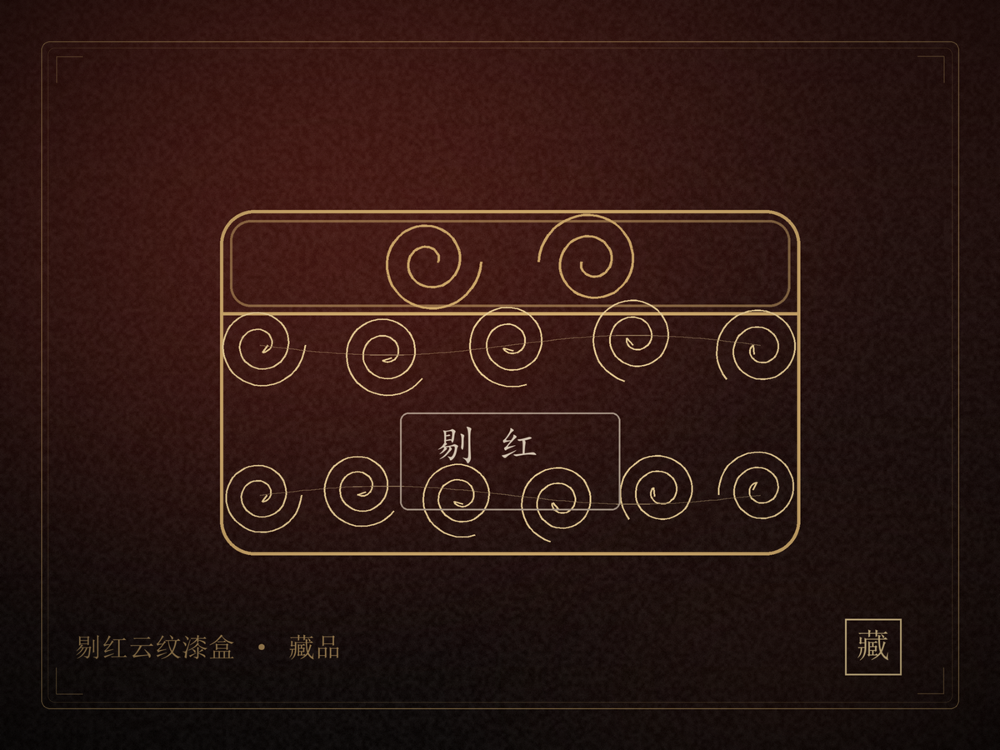

| 项目 | 内容 |
| --- | --- |
| 年代 | 当代 · 仿明式 |
| 材质 | 木胎 · 大漆 |
| 图片文件 | `art-box.png`（1170 KB） |
| 资料来源 | 演示数据 |

**工艺特征**

以木胎髹涂数十道大漆，盒面雕填云气纹，填金处含蓄内敛。

**器物故事**

漆盒是漆器中最贴近日常的器类，从妆匣到食盒，盛放着古人的生活细节。

**纹样寓意**：云气流转，生生不息。

**关联内容**：工艺「成都漆艺」、传承人「张永贵（演示）」

### 嵌锡漆碗（演示）

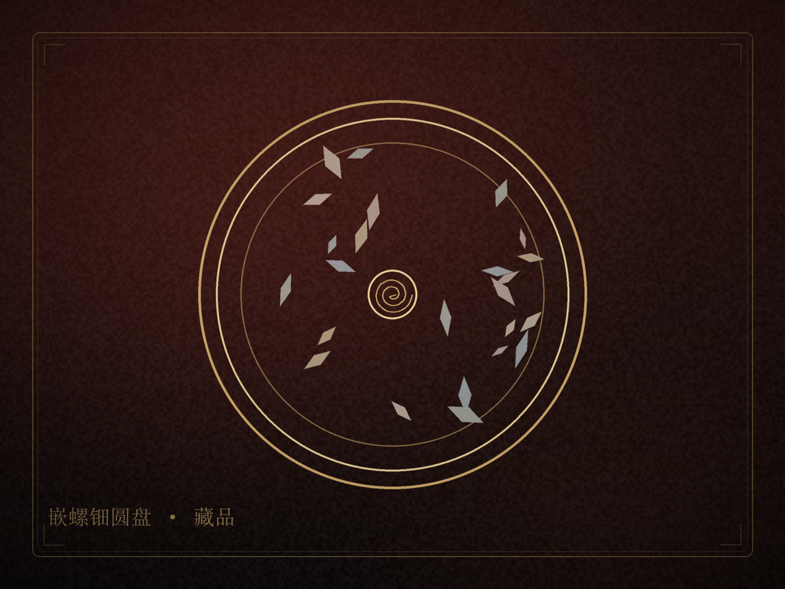

| 项目 | 内容 |
| --- | --- |
| 年代 | 当代 |
| 材质 | 木胎 · 大漆 · 锡片 |
| 图片文件 | `art-dish.png`（1159 KB） |
| 资料来源 | 演示数据 |

**工艺特征**

碗壁嵌锡片成纹，锡的银亮与大漆的深沉互为映衬。

**器物故事**

嵌锡为成都漆艺独有技法，锡片嵌入漆层后磨平，图案与漆面浑然一体。

**纹样寓意**：银锡映漆，贫而不陋。

**关联内容**：工艺「成都漆艺」

### 隐花漆屏（演示）

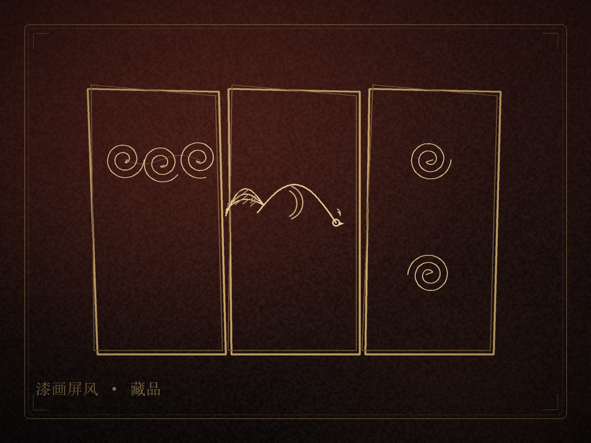

| 项目 | 内容 |
| --- | --- |
| 年代 | 当代 · 双面 |
| 材质 | 木胎 · 大漆 · 蛋壳 |
| 图片文件 | `art-screen.png`（1144 KB） |
| 资料来源 | 演示数据 |

**工艺特征**

屏心以蛋壳镶嵌变体鸟纹，漆色深处蛋壳如月光浮出。

**器物故事**

漆屏是漆艺与家具的结合，一面观纹、一面观漆，是漆艺集大成的载体。

**纹样寓意**：夜色藏鸟，静默生辉。

**关联内容**：传承人「李秀英（演示）」

## 四、传统工艺

### 成都漆艺

| 项目 | 内容 |
| --- | --- |
| 概述 | 成都漆艺以「三废」利用与精工细作著称，胎体轻巧、漆层丰厚、雕嵌填彩，兼具实用与审美，2006 年列入首批国家级非物质文化遗产名录。 |
| 技艺特色 | 以雕填、嵌锡、隐花为三大特色技法，漆面温润如玉，纹饰含蓄典雅。 |
| 口径说明 | 本工艺为演示数据，工序以传统制胎至成器的典型流程组织，实际因器而异。 |
| 资料来源 | 演示数据 |

**工序流程**

| 顺序 | 工序 | 说明 | 配图 |
| --- | --- | --- | --- |
| 1 | 制胎 | 选木旋制或夹纻塑形，做出器物骨架，要求壁厚均匀、接口严合。 | `demo-img2`（运行期上传） |
| 2 | 裱布刮灰 | 胎体裱糊麻布、刮漆灰，封固胎面并增加强度，防裂防变形。 | `demo-img3`（运行期上传） |
| 3 | 髹涂 | 反复髹涂大漆，每道入荫房荫干后打磨，累积漆层至足够厚度。 | `demo-img4`（运行期上传） |
| 4 | 雕填抛光 | 在厚漆上雕出纹样，填入色漆或金银箔，整体推光至温润如玉。 | `demo-img5`（运行期上传） |

## 五、传承人

两位人物均为演示设定（非真实人物），分别代表资深匠人与青年研究者两种视角。

### 张永贵（演示）

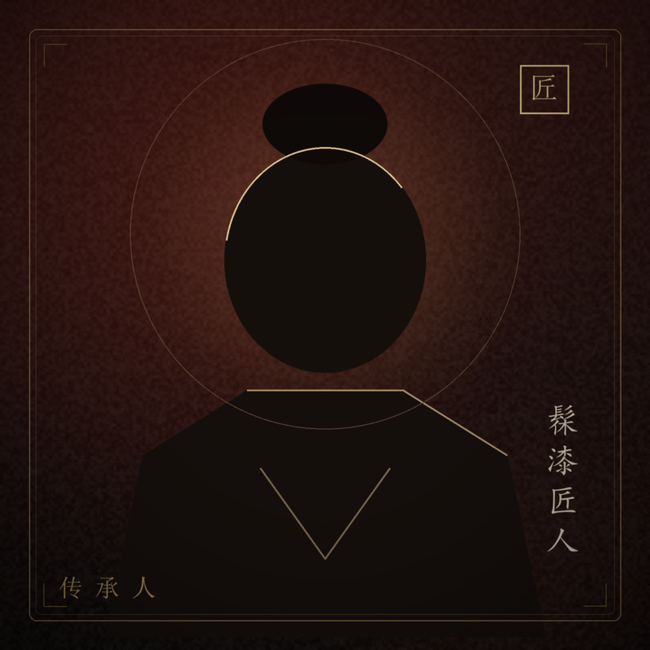

| 项目 | 内容 |
| --- | --- |
| 简介 | 从艺四十年的漆艺匠人，长于雕填与嵌锡技法。 |
| 从艺经历 | 十六岁进漆器厂学徒，师从老艺人学习制胎与髹涂，四十岁后自立工作室带徒传艺。 |
| 照片文件 | `inheritor-1.png`（504 KB） |
| 资料来源 | 演示数据，非真实人物 |

> 「漆要人养，人也要靠漆磨性子。一年只做几件东西，做一件就得对得起一件。」

章节中的口述：「漆要人养，人也要靠漆磨性子。一年只做几件东西，做一件就得对得起一件。」（工坊访谈（演示））

### 李秀英（演示）

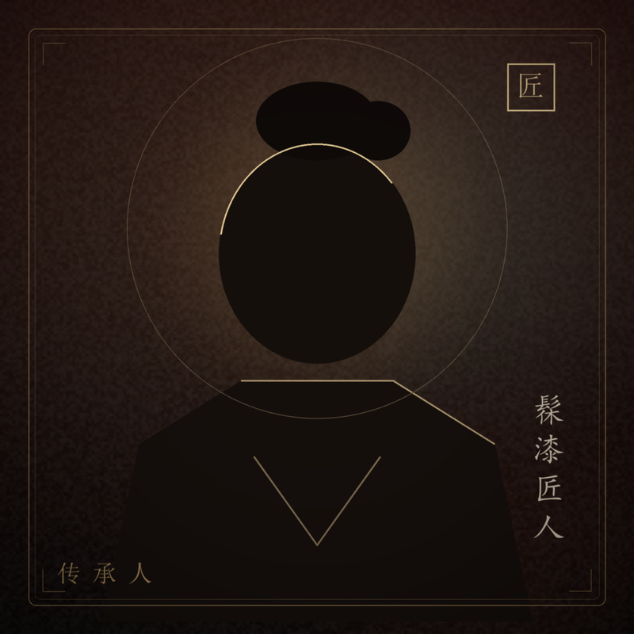

| 项目 | 内容 |
| --- | --- |
| 简介 | 青年漆艺研究者，专注成都漆艺的当代转化与文创设计。 |
| 从艺经历 | 美术学院工艺美术专业毕业，进入漆艺工作室系统学习，参与多个漆艺研修项目。 |
| 照片文件 | `inheritor-2.png`（497 KB） |
| 资料来源 | 演示数据，非真实人物 |

> 「老手艺要活在新生活里，才能传得下去。」

章节中的口述：「老手艺要活在新生活里，才能传得下去。我把雕填纹样做进文创，就是想让年轻人先「看见」，再「喜欢」。」（工作室访谈（演示））

## 六、纹饰

三种纹样分别出现在漆盒、边饰与漆屏的讲述中，是解读器物精神世界的入口。

### 云气纹

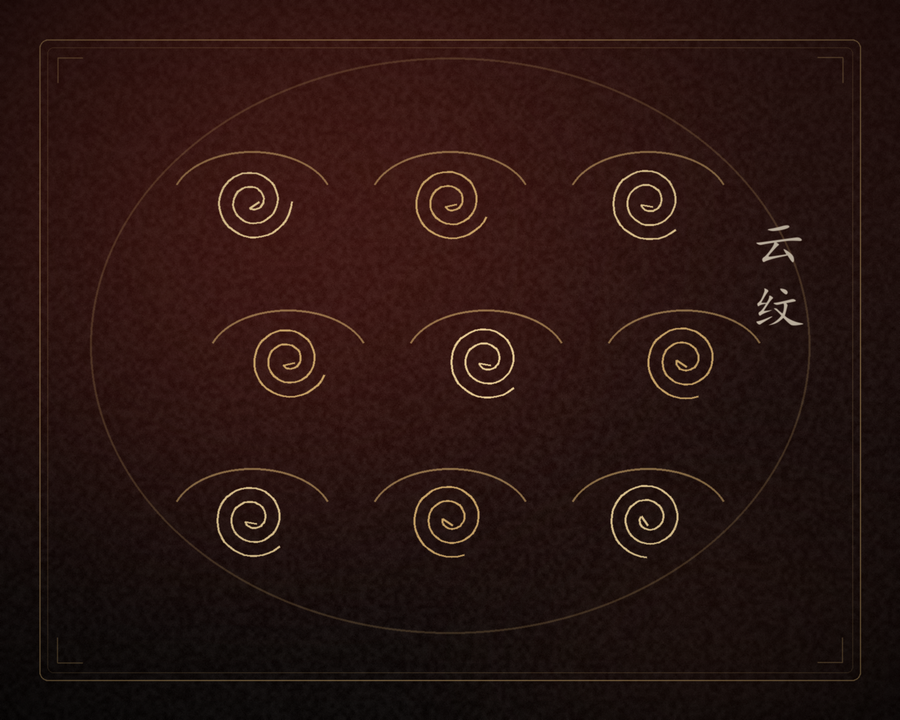

| 项目 | 内容 |
| --- | --- |
| 文化释义 | 战国秦汉漆器上最典型的纹样，流转的云气象征天地呼吸与生命气息。 |
| 图片文件 | `motif-cloud.png`（714 KB） |
| 资料来源 | 演示数据 |

### 卷草纹

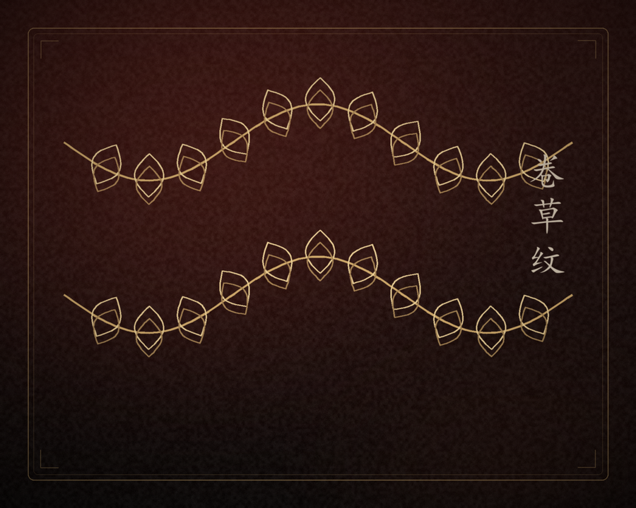

| 项目 | 内容 |
| --- | --- |
| 文化释义 | 取植物蔓卷之态，寓意生生不息，常见于漆盒边饰与器盖。 |
| 图片文件 | `motif-grass.png`（737 KB） |
| 资料来源 | 演示数据 |

### 变体鸟纹

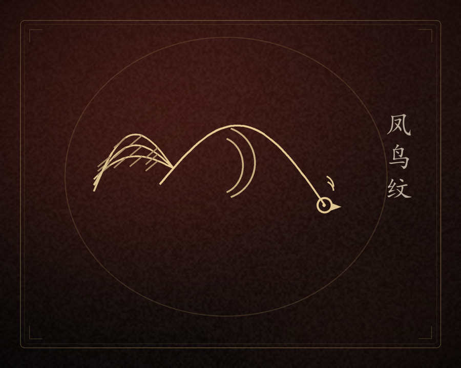

| 项目 | 内容 |
| --- | --- |
| 文化释义 | 由楚文化凤鸟纹简化而来，线条飞扬，体现楚人对自由的向往。 |
| 图片文件 | `motif-bird.png`（684 KB） |
| 资料来源 | 演示数据 |

## 七、术语释义

正文出现术语标记时，小程序以浮层展示下列释义。

| 术语 | 释义 | 来源 |
| --- | --- | --- |
| **大漆** | 大漆又称生漆、国漆，是从漆树割取的天然涂料，具有耐酸、耐碱、耐磨的特性，是漆艺的根本材料。 | 演示数据 |
| **胎体** | 承载漆层的骨架，可用木、竹、脱胎夹纻、金属等材料制成，胎体的整形直接影响器物的最终形态。 | 演示数据 |
| **髹涂** | 将大漆反复涂施于胎体表面的工序，每涂一层需入荫房干燥，再打磨，逐层累积，少则十几道，多则上百道。 | 演示数据 |
| **雕填** | 在厚漆层上雕出纹样轮廓，再填以色漆或金银箔的装饰技法，是成都漆艺的代表性工艺之一。 | 演示数据 |
| **荫房** | 大漆干燥的特殊温湿度控制房间。大漆并非晒干而是荫干，湿度不足反而难干，故有「荫房里出活」之说。 | 演示数据 |

## 八、历史时间轴

时间轴节点位于「第一章 · 千年漆语」，按朝代顺序展示漆器与成都漆艺的关键节点。

| 时期 | 事件 | 说明 |
| --- | --- | --- |
| 商周时期 | 漆用作礼器涂饰 | 商周时期，漆已用于木器与礼器的涂饰保护，漆器与青铜器并行发展，成为早期礼制生活的重要材质。 |
| 战国至秦汉 | 楚漆器的黄金时代 | 战国至秦汉，楚地漆器造型奇巧、纹饰飞扬，饮食器、家具、葬具全面漆化，是中国漆器史上的第一个高峰。 |
| 汉代 | 蜀郡漆器名满天下 | 汉代成都设工官专管漆器生产，蜀郡漆器远销边疆与海外，「蜀汉工官」的铭文漆器屡有出土。 |
| 明清时期 | 雕填与嵌锡技艺成熟 | 明清时期，成都漆艺的雕填、嵌锡、隐花等技法日臻成熟，宫廷与民间互为滋养，形成地方特色体系。 |

## 九、内容关联

后台通过内容关联把章节、藏品、工艺与人物串成网状结构，小程序详情页据此生成关联卡片。

| 来源 | 关联到 |
| --- | --- |
| 藏品「雕填云纹漆盒（演示）」 | 工艺「成都漆艺」 |
| 藏品「雕填云纹漆盒（演示）」 | 传承人「张永贵（演示）」 |
| 藏品「嵌锡漆碗（演示）」 | 工艺「成都漆艺」 |
| 藏品「隐花漆屏（演示）」 | 传承人「李秀英（演示）」 |
| 章节「第一章 · 千年漆语」 | 藏品「雕填云纹漆盒（演示）」 |
| 章节「第一章 · 千年漆语」 | 工艺「成都漆艺」 |
| 章节「第一章 · 千年漆语」 | 传承人「张永贵（演示）」 |
| 章节「第二章 · 器物之美」 | 藏品「嵌锡漆碗（演示）」 |
| 章节「第二章 · 器物之美」 | 藏品「隐花漆屏（演示）」 |
| 章节「第二章 · 器物之美」 | 传承人「李秀英（演示）」 |

## 十、静态资源

### 10.1 展示用种子图（后端静态目录）

位置：`qi/src/main/resources/static/seed/`，共 18 张，访问前缀 `/seed/`。均由 `qi/seed-assets/generate_seed_images.py` 生成，路径替换脚本为 `qi/sql/upgrade-20261113-seed-images.sql`。

| 文件 | 大小 | 用途 | 使用位置 |
| --- | --- | --- | --- |
| `art-box.png` | 1170 KB | 藏品主图 | 雕填云纹漆盒 |
| `art-dish.png` | 1159 KB | 藏品主图 | 嵌锡漆碗 |
| `art-screen.png` | 1144 KB | 藏品主图 | 隐花漆屏 |
| `chapter-art.png` | 1317 KB | 章节封面 | 第二章 · 器物之美 |
| `chapter-branch.png` | 1289 KB | 章节封面 | 互动体验 · 分支参观 |
| `chapter-main.png` | 1337 KB | 章节封面 | 第一章 · 千年漆语 |
| `inheritor-1.png` | 504 KB | 传承人照片 | 张永贵 |
| `inheritor-2.png` | 497 KB | 传承人照片 | 李秀英 |
| `motif-bird.png` | 684 KB | 纹饰图 | 变体鸟纹 |
| `motif-cloud.png` | 714 KB | 纹饰图 | 云气纹 |
| `motif-grass.png` | 737 KB | 纹饰图 | 卷草纹 |
| `node-art.png` | 888 KB | 正文配图 | 细看漆盒 / 漆屏节点 |
| `node-deco.png` | 865 KB | 正文配图 | 饰纹坊、髹涂节点 |
| `node-ending.png` | 868 KB | 正文配图 | 汇合节点 |
| `node-life.png` | 865 KB | 正文配图 | 漆与生活节点 |
| `node-tree.png` | 875 KB | 正文配图 | 割漆节点 |
| `node-trip.png` | 856 KB | 正文配图 | 制胎坊两个节点 |
| `node-view.png` | 889 KB | 正文配图 | 入行 / 器以载道节点 |

全部 18 张图片均在已发布内容中被实际引用，没有闲置种子图。

### 10.2 小程序内置图标（打包资源）

位置：`fronted/漆器云馆/static/`，随小程序包发布，改动后需重新编译。

| 文件 | 大小 | 用途 |
| --- | --- | --- |
| `logo.png` | 4 KB | 品牌 logo |
| `tab/home.png` | 542 B | tabBar「首页」未选中 |
| `tab/home-active.png` | 769 B | tabBar「首页」选中 |
| `tab/hall.png` | 505 B | tabBar「云展馆」未选中 |
| `tab/hall-active.png` | 724 B | tabBar「云展馆」选中 |
| `tab/artifact.png` | 815 B | tabBar「藏品」未选中 |
| `tab/artifact-active.png` | 1 KB | tabBar「藏品」选中 |
| `tab/member.png` | 689 B | tabBar「我的」未选中 |
| `tab/member-active.png` | 1016 B | tabBar「我的」选中 |

tabBar 文字颜色：未选中 `#6f665c`，选中 `#9b2d20`；未选中色与米色背景对比度约 5.5:1，满足可读性要求。图标为 81×81 PNG 透明底双态成对输出。

### 10.3 运行期上传图（不在仓库内）

工艺工序配图走媒体库：上传后保存在 `D:/shuqi-upload/`，由后端映射为 `/files/**`，不入 Git 仓库。当前展示用到的 4 张：

| 媒体 ID | 媒体名 | 文件名 | 使用位置 |
| --- | --- | --- | --- |
| 2 | demo-img2 | `c9ac926dbea34d04b052f25241ce8546.jpg` | 工序「制胎」 |
| 3 | demo-img3 | `c641d573dc5245698f04ccf0b8ace61c.jpg` | 工序「裱布刮灰」 |
| 4 | demo-img4 | `add8a7596e1349bf9404d5ee088e3636.jpg` | 工序「髹涂」 |
| 5 | demo-img5 | `79762abab4c540e3bc91db3dbf524a3f.jpg` | 工序「雕填抛光」 |

> 另有 2 张演示上传图（媒体 ID 1、6）未被已发布页面实际显示：媒体 6 虽登记在工序节点上作为「工坊场景」配图，但章节页不渲染节点媒体列表。部署到新环境时需重新上传或同步 `D:/shuqi-upload/` 目录，否则工序图会缺省。

## 附：未纳入展示的数据

数据库中共有 12 个章节、3 件藏品、2 项工艺、4 位传承人、10 条术语、6 种纹饰、8 个历史事件。除上文列出的已发布记录外，其余为：

- 章节：`smoke-*` / `log-*` / `flow-demo` / `neg-*` 等 smoke 测试记录（已软删除），`legacy-linear`（已下架），以及「第一章 · 千年漆语」的草稿副本（`chapter_id=10`，节点 33–37）。草稿副本与已发布章节内容重复，不对外展示。
- 藏品：3 件全部发布。
- 工艺：1 条旧版本记录（`craft_id=1`，与展示版同名）已软删除，避免与 `craft_id=2` 重复。
- 传承人：2 条旧版本记录（`inheritor_id=1、2`）已软删除。
- 术语：5 条旧版本记录（`term_id=1–5`）已软删除。
- 纹饰：3 条旧版本记录（`motif_id=1–3`）已软删除。
- 历史事件：4 条旧版本记录（`event_id=1–4`）已软删除。

文字校订提示：「成都漆艺」概述中的「三废」一词疑为「三雕」的笔误；为保证文档与线上展示一致，此处保留数据库原文。

